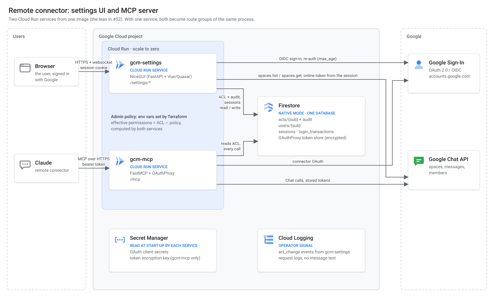

# 04 — Settings UI: server side

The backend behind `/settings` (issue #52): Google sign-in, listing the user's spaces, and storing the per-user ACL that the MCP server (#53) enforces. It serves the user flow in [03-settings-ui-flow.md](03-settings-ui-flow.md) (#51) and builds on [02-settings-page-direction.md](02-settings-page-direction.md).

Constraints from #29: GCP only (NFR-1), zero running cost for at most 40 users with very low concurrency (NFR-2), a database sized for a handful of records (NFR-3), Google Sign-In with the connector's identity (NFR-4), a minimal stack (NFR-5).

### Decisions recorded in #29

The open points of the research, as decided by the owner on 2026-11-04:

| # | Point | Decision | Effect on this document |
|---|---|---|---|
| 1 | Who operates the server | **One instance per Workspace organisation** | One organisation per deployment, with its domains in `ALLOWED_DOMAINS`; no tenant field in the data model |
| 2 | Storage backend | **Firestore** | As designed |
| 3 | Local stdio mode | **Kept**, as an alternative to the remote connector on the same core (NFR-6) | See [Place in the codebase](#place-in-the-codebase-nfr-6-nfr-7) |
| 4 | Direct messages | **The UI shows only a "not available yet" notice** in their place; not enabled in v1 | No Chat call for DMs; the server still refuses any entry whose `spaceType` is not `SPACE` (check 4) |
| 5 | Re-authentication before granting write | **Not required.** The confirmation is there to keep the LLM under control, not as a security barrier | Re-authentication removed; the confirmation page alone is used |
| 6 | One service or two | **Two services** | As designed; see the last section |
| NFR-6 | One core, local mode always runnable | The two modes are **alternatives**: a Claude client uses the local server or the remote connector, never both. They share the code of the core, not data: permissions set with `--space` and permissions set on `/settings` are never synchronised | The settings app depends on the core, never the other way round; one `Permissions` type in the core |
| NFR-7 | What may be merged into `main` | Partial remote work may be merged; a broken local server may not | Implementation order and partial entry points below; tests in `tests/test_local_mode.py` |

---

## Architecture

Two Cloud Run services, as decided in #29 (see [Decisions recorded in #29](#decisions-recorded-in-29)).

**Addresses, without a load balancer.** Each service keeps its own Cloud Run address, so no HTTPS load balancer is needed (it is not free and would break NFR-2):

| Service | Address | Configured as |
|---|---|---|
| `gcm-settings` | `https://gcm-settings-<hash>.<region>.run.app/settings` | `SETTINGS_BASE_URL` = `https://gcm-settings-<hash>.<region>.run.app` |
| `gcm-mcp` | `https://gcm-mcp-<hash>.<region>.run.app/mcp` | the connector URL entered in Claude |

- The link the MCP tools return is `{SETTINGS_BASE_URL}/settings`, read from the MCP service's configuration. It is not derived from the MCP request's host, which is a different service. This replaces `{base_url}/settings` in 02 and 03.
- The two services are two origins. That is what we want: the settings cookies are never sent to `/mcp`, and the Origin check in [CSRF](#csrf) compares against `SETTINGS_BASE_URL` only.
- A custom domain per service (Cloud Run domain mapping, no load balancer) is optional and changes nothing in the design, only the two values above.



Icons: [Google Cloud product icons](https://cloud.google.com/icons). The diagram is a plain SVG file and can be edited directly.

Who reads and writes what in Firestore:

| Collection | `gcm-settings` | `gcm-mcp` |
|---|---|---|
| `acls/{sub}` + `audit` | read / write, one transaction | read only, on every tool call |
| `users/{sub}` | read `last_mcp_seen_at` | write `last_mcp_seen_at` |
| `sessions`, `login_transactions` | read / write | — |
| `OAuthProxy` token store (encrypted) | — | read / write |

The two services share only the Google `sub` and the configuration in Secret Manager and environment variables. IAM cannot enforce this table, because both service accounts can reach the whole database; the code does (see [Access to Firestore by service](#access-to-firestore-by-service)).

---

## Decisions

| # | Decision | Reason |
|---|---|---|
| S1 | **Cloud Run, scale to zero**, `max-instances` capped at 2. Cold starts are accepted. | Only serverless runtime with a free tier that fits NFR-2. The cap bounds the cost of a runaway client. |
| S2 | **NiceGUI** for the pages (`@ui.page`), on its own FastAPI app. Sign-in, callback and sign-out stay plain FastAPI routes. Accepted costs, all detailed in [NiceGUI: consequences and rules](#nicegui-consequences-and-rules): JavaScript and a websocket are required, the CSP must allow `'unsafe-inline'` and `'unsafe-eval'`, and an open tab keeps a Cloud Run instance billed. | NFR-5 read as "simple for the team that maintains it": the team knows NiceGUI. The pages stay in Python, with no templates or front-end code to write. |
| S3 | **Firestore (Native mode), one database.** Server access only, through IAM; Security Rules deny every client SDK request. | Free tier covers the volume (NFR-3). Nothing in the browser talks to Firestore directly. |
| S4 | **One ACL document per user** (`acls/{sub}`), with all entries in a map. Each entry keeps a snapshot of the space's display name. Concurrent changes are detected by comparing the ACL with what the confirmation was computed on, as in the `AclStore` interface of #57. | The warnings and the re-validation of 03 step 6–7 depend on the whole ACL. One document gives one read per MCP call, and the comparison runs inside the write transaction. |
| S5 | **Server-side sessions in Firestore.** The cookie holds only a random ID; the database stores its SHA-256. | Real logout and revocation. No signing key to manage. A database leak yields no usable cookie. |
| S6 | **The online access token lives in the session document only**, and the session never outlives it. No refresh token is ever requested. | The picker and the save-time membership check need a Chat token; nothing outlives the session. |
| S7 | **`sub` comes from the session only.** No route, form field or query parameter carries a user identifier. | IDOR is impossible by construction, not by a check that could be forgotten. |
| S8 | **Effective permissions = stored ACL ∩ admin policy**, computed at save time *and* by the MCP server on every call. | A policy tightened after a save must apply at once, without rewriting users' ACLs. |
| S9 | **Audit record written in the same transaction as the ACL change**, in a per-user subcollection with a one-year TTL. | No change without a record. The user can see their own history. |
| S10 | **Its own package** (`google_chat_mcp.settings`): the pages and plain routes are registered on NiceGUI's FastAPI app and served with `ui.run`, from its own entry point, deployed as its own Cloud Run service. | Two services, as decided in #29; see the last section. NFR-6: the package is outside the core and its dependencies are in the `remote` extra. |

---

## Place in the codebase (NFR-6, NFR-7)

The settings app is remote-only, but it lives in the same codebase and version as the local server. NFR-6 and NFR-7 on #29 decide where it goes and how it reaches `main`.

### Packages and the direction of dependencies

| Package | Role | May import |
|---|---|---|
| core (`google_chat_mcp`: tools, Chat client, `Permissions`, the `AclProvider` and credentials interfaces) | Shared by both modes; does not know which mode it runs in | nothing below |
| local adapters (`config.py` for `--space`, `auth.py` for `token.json`, `__main__.py`) | Local mode only | core |
| `google_chat_mcp.remote` (Firestore `AclProvider`, `OAuthProxy` credentials, admin policy, Firestore client) | Shared by the two remote services; designed in #53 | core |
| `google_chat_mcp.settings` (this document) | The settings service | core, `google_chat_mcp.remote` |

- **Dependencies point towards the core, never away from it.** `tests/test_local_mode.py` already fails the build if a local module imports `settings` (or `remote`), or if starting local mode loads them.
- **One `Permissions` type, in the core.** It defines read, write and unattended, and which combinations are valid. The tools apply it; `--space` (local) and the `/settings` page (remote) produce it. Today the settings package has its own copy (`settings/models.py`, from #57), equivalent to `parse_space_arg`'s rules; it moves to the core with the refactoring of #53, and the settings package imports it from there.
- **No data is shared between the modes.** The two modes are alternatives for a Claude client (NFR-6). Permissions given with `--space` and permissions saved on `/settings` are separate and never synchronised; a user moving from local to remote sets them again on `/settings` (migration guide in #59).
- **What the settings page says about the core is tested.** The page names the tools `send_message` and `send_message_unattended`; a test checks that those tools exist in the core's server, so renaming a tool breaks the build instead of leaving the page out of date.

### Entry points

| Entry point | What it is | Without the `remote` extra |
|---|---|---|
| `google-chat-mcp` (stdio) | Local mode; unchanged by this work | works |
| `python -m google_chat_mcp.settings.mock` | Development mock, fake sign-in, in-memory data (#57) | stops with a message naming the extra |
| `python -m google_chat_mcp.settings` | The settings service as deployed on Cloud Run | stops with a message naming the extra |

The production entry point refuses to start ("not implemented yet") until its real backends exist: Google sign-in, `SpacesSource` on the Chat API, `AclStore` and sessions on Firestore. It never falls back to the mock.

### Implementation order (NFR-7)

Each step can be merged on its own, with local mode untouched and the NFR-7 tests green:

1. **Pages and flow with an in-memory backend** (#57): done in draft.
2. **The core's `Permissions` type** (with #53's refactoring of the core); the settings package switches to it.
3. **Firestore backends** (`AclStore`, sessions, login transactions, `ConnectorUsage`), tested against the Firestore emulator.
4. **Google sign-in** and **`SpacesSource` on the Chat API**.
5. **Production entry point and security middlewares in their final form** (Origin check against `SETTINGS_BASE_URL`, idle disconnect of tabs). From this step the service can be deployed (#61), from `stable` only.

Until step 5, every merged step says in its pull request what is still missing, and nothing is deployed for users.

### Releases

Both remote services are deployed from the commit marked `stable`, the same commit local users get with `uvx …@stable`. A change to the settings app that needs a change in the MCP server (for example a new field in the ACL) follows the schema rule in [Schema versioning](#schema-versioning): readers first, writers second, each in its own `stable`.

---

## Sign-in flow

### OAuth client

- One "Web application" OAuth client for `/settings`, in the same GCP project and under the same consent screen (Internal) as the connector's client. A second client keeps the two client secrets apart; both clients see the same `sub`, because Google's `sub` is per account, not per client.
- Redirect URI: `{SETTINGS_BASE_URL}/settings/callback`.
- Authorization request:
  - `scope=openid email https://www.googleapis.com/auth/chat.spaces.readonly`
  - `access_type=online` (no refresh token)
  - `response_type=code`, PKCE `S256`, a random `state` and `nonce`
  - `hd={domain}` as a hint only when `ALLOWED_DOMAINS` has a single domain (Google accepts one value); the claim is checked on return
  - `prompt=select_account` only for **[Switch account]**

### Login transaction

Before the redirect to Google, the server stores a transaction in `login_transactions/{sha256(tx_id)}`:

```
{ state, nonce, code_verifier, select_account, created_at, expire_at }
```

- `tx_id` is 32 random bytes, sent in a cookie `__Host-gcm_login` (`Secure`, `HttpOnly`, `SameSite=Lax`, `Max-Age=600`).
- TTL 10 minutes, enforced both by the code and by a Firestore TTL policy on `expire_at`. The 10 minutes also absorb a cold start on the way back.
- The transaction is deleted when the callback consumes it, so a `code` or `state` can be used only once.

### Callback (`GET /settings/callback`)

1. Load the transaction from the cookie; reject if missing, expired, or `state` differs. The cookie binds the flow to this browser, which stops login CSRF.
2. Exchange the code with the PKCE verifier.
3. Verify the ID token with `google-auth`: signature, `iss`, `aud` = this client, `exp`, `nonce`, `email_verified == true`, `hd` in `ALLOWED_DOMAINS` (see [Admin policy](#admin-policy)). On failure: generic error page, nothing stored.
4. Check that the granted scopes include `chat.spaces.readonly`. If the user unticked it on the consent screen, show a page explaining that the list of spaces cannot be read without it.
5. Create a new session (never reuse an ID from before the login, against session fixation) and delete the transaction.
6. Redirect (303) to `/settings`. The target is fixed: there is no `next` parameter, so no open redirect.

### Session

Document `sessions/{sha256(session_id)}`:

```
{
  sub, email,
  access_token, token_expires_at,
  created_at, last_seen_at, expire_at,     # expire_at drives the TTL policy
  pending_change,                          # see "Confirmation"
}
```

| Property | Value | Why |
|---|---|---|
| Cookie | `__Host-gcm_session`, `Secure`, `HttpOnly`, `SameSite=Lax`, `Path=/`, no `Domain` | `__Host-` pins it to this origin. `Lax`, not `Strict`: the user arrives from a link in Claude and returns from Google, both cross-site navigations. CSRF is handled as described in [CSRF](#csrf). |
| Idle timeout | 30 minutes for the session; **10 minutes without user events for an open tab**, after which the server closes the tab's websocket (see [Runtime and cost](#runtime-and-cost)) | Per 02. `last_seen_at` is rewritten at most once a minute to save writes. |
| Absolute lifetime | `min(token_expires_at − 2 min, created_at + 60 min)` | The session never outlives the Chat token it carries (S6), so a save never fails on an expired token halfway. |
| Logout (**[Sign out]** button) | The event handler deletes the session document, then navigates to `GET /settings/signed-out`, which clears the cookie | Real revocation (S5): the session is gone before the navigation. The Google token is not revoked: it is the user's own short-lived token and expires within the hour. |
| Expiry during the flow | The next event finds no valid session and navigates to sign-in, then to `/settings`; the interrupted step is dropped | As 03 step 8: a write grant is never left half done. |

**Stated precisely:** `/settings` stores no refresh token and no Google credential that outlives the session. The access token sits in the session document for at most an hour, encrypted at rest by Firestore, and is deleted at logout or by the TTL policy.

---

## Listing spaces

All Chat calls use the session's access token, never the connector's tokens.

| Page | Call | Notes |
|---|---|---|
| Enabled list (page `/settings`) | `spaces.list` with no filter, all pages (`pageSize=1000`) | Used to name the ACL entries and to detect **orphaned entries**: ACL keys absent from the result, labelled with their stored name snapshot. |
| Direct messages tab | none | Shows only the "not available yet" notice (decision 4 in #29). No `memberships.list` calls until the view is built. |
| Picker (page `/settings/spaces/add`) | `spaces.list` with `filter=spaceType = "SPACE"`, once when the page is built | The search box filters the list in the page's server-side state as the user types (debounced), case-insensitive substring on `displayName`. Results sorted by name, then resource name. |
| Pasted link or ID (picker page, **[Use]**) | `spaces.get` | The server extracts the space ID from a `chat.google.com` URL or `spaces/ID` string with a strict pattern. Anything else: "Not a Google Chat space link". |
| Permissions page, and every save | `spaces.get` | Membership check: with user authentication Google returns the space only if the user can see it. `spaceType` must be `SPACE` (03, step 7). |

- **No cache** across pages: one `spaces.list` per page build is cheap at this scale, and a cache would show spaces the user has just left. Within one open picker the list is kept in memory, so typing in the search box costs no Chat call.
- **Chat API errors:** `401` ends the session (token revoked or expired); `403`/`404` on `spaces.get` means "You are no longer a member of this space" (03 step 8); `429`/`5xx` shows a retry page and changes nothing.
- **Space names never go to logs**, nor does `q`.

---

## Data model

Firestore, Native mode, one database. Every document carries `schema_version`.

```
users/{sub}                         written by the MCP server; read by /settings
  schema_version: 1
  email
  created_at
  last_mcp_seen_at                  # rewritten at most once an hour

acls/{sub}                          written by /settings; read by the MCP server
  schema_version: 1
  updated_at
  entries: {
    "AAABBBCCC": { read: true,  write: true,  unattended: false, display_name: "Team General", updated_at },
    "REPORTS01": { read: false, write: true,  unattended: true,  display_name: "Reports",      updated_at }
  }

acls/{sub}/audit/{auto_id}          written by /settings in the same transaction
  schema_version: 1
  changed_at, expire_at              # expire_at = changed_at + 365 days (TTL policy)
  space: "AAABBBCCC"
  before: { read, write, unattended } | null
  after:  { read, write, unattended } | null
  session: sha256(session_id)[:16]  # correlates the changes of one session

sessions/{sha256(session_id)}       see "Session"
login_transactions/{sha256(tx_id)}  see "Login transaction"
```

- **Keys** are the space ID without the `spaces/` prefix, so map keys need no quoting in field paths. The ID is validated against `^[A-Za-z0-9_-]{1,128}$` before use.
- **`display_name`** is a snapshot taken at save time, used only as the label of an orphaned entry. It is untrusted text (anyone who creates a space chooses it): never used for a decision, never logged, rendered only under the [rendering rules](#rendering-rules-stored-xss), and ignored by the MCP server.
- **Invariants**, enforced by the core's `Permissions` type, which both `/settings` (when it saves) and the MCP server (when it reads) use (Firestore has no `CHECK`; see [Place in the codebase](#place-in-the-codebase-nfr-6-nfr-7)):
  - `unattended ⇒ write` (the same rule `--space` follows in local mode);
  - `read or write` (an entry with no permission is deleted, not stored);
  - at most 200 entries per user, far above real use, to bound the document.
- **Why `users` and `acls` are separate:** the MCP server writes `last_mcp_seen_at`; keeping it out of the ACL document means the MCP server never needs to write `acls`. IAM cannot enforce that (see [Access to Firestore](#access-to-firestore-by-service)), so the MCP code does.
- **A new user** has no `acls/{sub}` document; it reads as an empty ACL (the empty state of 03).

### Schema versioning

- Readers accept `schema_version` equal to the current version or the previous one, and upgrade the previous one in memory.
- Writers always write the current version, so documents migrate on their next change. No batch migration job.
- **A version higher than the reader knows fails closed:** the MCP server treats the ACL as empty and `/settings` refuses to write. This protects a rollback of one service after the other has written a newer schema.
- A change that cannot be read by the previous version is deployed in two steps: readers first, writers second.

---

## Routes, pages and actions

With NiceGUI, state changes are **event handlers** running on the server (a button click arrives over the page's websocket), not `POST` endpoints. The table lists the HTTP routes, the pages, and the actions on each page.

All paths are under `/settings`. Every page requires a valid session; without one, it redirects to `login`.

**Plain FastAPI routes** (no NiceGUI):

| Route | Purpose | State change |
|---|---|---|
| `GET /settings/login` | Starts sign-in (also used by **[Switch account]** with `?select_account=1`) | Creates a login transaction |
| `GET /settings/callback` | OAuth callback | Creates the session |
| `GET /settings/signed-out` | Clears the session cookie and shows the signed-out page. The session document is already deleted by the **[Sign out]** handler | — |

**NiceGUI pages** (`@ui.page`):

| Page | Shows | Actions (event handlers) |
|---|---|---|
| `/settings` | Enabled list, account bar, connector status | **[Remove]** (also for orphaned entries) → ACL; **[Sign out]** → deletes the session |
| `/settings/spaces/add` | Picker with search box and pasted link | **[Use]** for a pasted link; **[Choose]** navigates to the permissions page |
| `/settings/spaces/{id}` | Permissions (add and edit) | **[Continue]**: saves directly when no confirmation is needed; otherwise stores `pending_change` and navigates to `confirm` → ACL, or session |
| `/settings/spaces/{id}/confirm` | Confirmation, built from `pending_change` | **[Grant]** commits the pending change → ACL |
| `/settings/history` | The user's own audit records, newest first, 50 per page | — |

`{id}` is a space ID, never a user ID (S7). Every page reads the session cookie from the request that loaded it (`@ui.page` handler with a `request: Request` argument) and keeps only the session ID in the page's server-side state. Every handler starts by **re-reading the session from Firestore** (it may have expired or been signed out from another tab), takes `sub` from it, and touches only `acls/{sub}` and `users/{sub}`. A test asserts that no route or page declares a parameter named `sub`, `user`, `email` or `uid`.

### Authorization checks on every write

In this order, before the transaction:

1. The session, re-read from Firestore, is still valid. The event arrived over the websocket of a page loaded with that session (see [CSRF](#csrf)).
2. `{id}` matches the ID pattern.
3. The values come from the page's server-side element state (checkboxes, radio), not from data sent by the browser alongside the event. `unattended` is ignored unless `write` is set, and a change carrying `unattended` without `write` is rejected (03 step 5). The page can now disable the write mode when Write is unchecked, but the server keeps the rule.
4. `spaces.get` succeeds with the session's token and `spaceType == "SPACE"`. Skipped only for **remove**, so the user can always clean up an orphaned entry.
5. The admin policy allows every requested permission for this space.
6. If the change needs confirmation (table in 03 step 6), the session holds a matching `pending_change` for this exact change.

Then, in one Firestore transaction (`AclStore.put_entry` / `delete_entry` from #57):
- read `acls/{sub}`;
- if the change was confirmed, check that the ACL's fingerprint (a hash of all entries' permissions) equals `pending_change.acl_fingerprint`;
- check that the entry's current permissions equal `expected_before`;
- write the entry and the audit record.

A mismatch means the ACL changed in another tab (`ConcurrentChange`); the user gets the permissions or confirmation page again, recomputed. Both checks read the same document inside the transaction, so nothing can slip in between the check and the write.

### Confirmation

- **[Continue]** on the permissions page stores in the session:
  `pending_change = { space, before, after, acl_fingerprint, warnings_hash, created_at }`.
  The confirmation page is built from it, so it cannot be tampered with between the two steps. It stays a separate page, not a `ui.dialog`: a dialog would hold the pending change only in the tab's memory, which is lost if the instance changes.
- The pending change expires after 10 minutes and is cleared after use, after any other save, and at logout.
- **No re-authentication** (decision 5 in #29). The confirmation exists so that the user, not the LLM, decides what Claude may reach: the model has no tool to change the ACL, and a person has to click **[Grant]** after reading the warnings. It is not meant to stop someone who already controls the user's browser session.

### CSRF

There are no forms posting to the server, so a synchronizer token in a hidden field no longer applies. The risk moves to the websocket: a page on another site opening a socket to `/settings` and sending events (cross-site WebSocket hijacking).

- **Origin check at the websocket handshake.** NiceGUI creates its Socket.IO server with `cors_allowed_origins='*'` (checked in NiceGUI 3.19), so it accepts any origin. An ASGI middleware in front of NiceGUI rejects every request to `/_nicegui_ws/` whose `Origin` is not `SETTINGS_BASE_URL`, and every request with no `Origin` at all.
- **Events only reach the page that created them.** A socket is bound to the page's client ID, which exists only in the page loaded by the user. An attacker without it cannot drive another user's page.
- **The session is re-validated on every event** (check 1), so a socket that survives a sign-out or an expired session changes nothing.
- `SameSite=Lax` on the session cookie is an extra layer: current browsers do not send it on cross-site websocket handshakes. The socket itself is not authenticated by the cookie, so this layer matters little.
- `GET` routes change no ACL.

---

## Admin policy

Deployment configuration (environment variables set by Terraform), read at start-up:

| Variable | Example | Effect |
|---|---|---|
| `ALLOWED_DOMAINS` | `example.com,example.it` | Required, at least one domain. Checked against `hd` in both flows. See the note below. |
| `POLICY_ALLOW_WRITE` | `true` | `false` disables Write for everyone. |
| `POLICY_ALLOW_UNATTENDED` | `false` | `false` disables "Write without confirmation" for everyone. |
| `POLICY_SPACE_ALLOWLIST` | `AAABBBCCC,DDDEEEFFF` | Optional. If set, only these spaces can be added. |

- `/settings` uses the policy to **disable options** with the reason (03 step 5), to **refuse saves** (step 7, check 5), and to mark stored entries that the current policy no longer allows: "Suspended by your administrator". Those entries keep their stored value, so loosening the policy restores them, and they can always be removed.
- The MCP server applies the same intersection on every call (S8), using the same policy module (`google_chat_mcp.remote.policy`, shared by the two remote services; local mode has no admin policy) and the same environment variables. A mismatch between the two services' configuration can only make the MCP server stricter than the page, never looser.
- An unknown or unparsable policy value stops the service at start-up.

**How `ALLOWED_DOMAINS` is read, and its limits:**
- It lists the domains of **the one Workspace organisation** this instance serves (decision 1): its primary domain and, if wanted, its secondary domains. It is not a way to admit other organisations: the OAuth consent screen is Internal, so Google already refuses accounts outside the organisation, and this list is a second check on top.
- The match is on the ID token's `hd` claim, exact and case-insensitive. Subdomains are not implied: `example.com` does not admit `eu.example.com`.
- Accounts without `hd` (consumer Google accounts) are always refused.
- A user whose primary address is on a domain missing from the list cannot sign in, even if they belong to the organisation. Alias domains need no entry, because `hd` follows the primary address.
- To verify before relying on it: which value Google puts in `hd` for users whose primary address is on a secondary domain (expected: that secondary domain).

---

## Audit log

- **What:** one record per ACL change (add, edit, remove): before → after, a short session correlation ID. No IP address, no user agent, no space names (the ID is enough and names can change).
- **Where:** `acls/{sub}/audit`, written in the same transaction as the change (S9). The user sees it on `/settings/history`; the operator reads it in the Firestore console.
- **Retention:** one year, through a Firestore TTL policy on `expire_at`. TTL deletion is asynchronous, so records may survive a little longer.
- **Operator signal:** each change also emits one structured log line to Cloud Logging (`event=acl_change`, hashed `sub`, space ID, after-state), so alerts can be set on, for example, every new unattended grant. Cloud Logging's default retention (30 days) applies to that copy. The log masking work recovered from #43 applies here.

---

## Security headers

Set by one middleware on every `/settings` response, NiceGUI's static files included:

```
Content-Security-Policy: default-src 'self';
                         script-src 'self' 'unsafe-inline' 'unsafe-eval';
                         style-src 'self' 'unsafe-inline';
                         img-src 'self' data:; font-src 'self'; connect-src 'self';
                         object-src 'none'; form-action 'self';
                         frame-ancestors 'none'; base-uri 'none'
X-Frame-Options: DENY
X-Content-Type-Options: nosniff
Referrer-Policy: no-referrer
Strict-Transport-Security: max-age=31536000
Cross-Origin-Opener-Policy: same-origin
Cache-Control: no-store
```

- **The CSP no longer stops injected scripts.** NiceGUI's page template carries inline scripts (the element tree is embedded in one), and `nicegui.js` evaluates code with `eval` and `new Function` (both checked in NiceGUI 3.19). NiceGUI has no nonce support, so `'unsafe-inline'` and `'unsafe-eval'` are required. What the CSP still does: blocks loading scripts and connections from other origins, framing, `<object>`, `<base>` rewriting and form posts elsewhere. Protection against stored XSS through space names now rests entirely on the rendering rules in the next section.
- `connect-src 'self'` covers the websocket to the same origin.
- `no-store` applies to pages; NiceGUI's versioned static files (`/_nicegui/{version}/…`) keep their own long cache headers, which is fine because they hold no user data.
- Escaping of what the user sees is #51's scope; the rules on which NiceGUI elements may carry data are below.

---

## NiceGUI: consequences and rules

Checked against NiceGUI 3.19.0, the current version on PyPI. To check again at the version pinned in `uv.lock`.

### Rendering rules (stored XSS)

Anyone who creates a space chooses its name, so space names, member names and anything returned by the Chat API are untrusted.

| Allowed for untrusted text | Forbidden for untrusted text |
|---|---|
| `ui.label`, `ui.table` / `ui.aggrid` cells as plain text, `ui.select` / `ui.input` values, `ui.notify` | `ui.html` (even with `sanitize=True`), `ui.markdown`, `ui.add_head_html` / `ui.add_body_html`, `ui.run_javascript`, `ui.navigate.to` with a URL built from data, table cell slots that render HTML |
| Props with a literal value | **Props whose name starts with `:`**: NiceGUI evaluates their value as JavaScript in the browser |

Enforced by:
- a CI check that fails if the settings package imports or calls any of the forbidden functions, or sets a `:`-prefixed prop;
- a test that builds every page with a space named `` `${alert(1)}` `` (covers HTML and the template literal that carries the element tree) and asserts that the name appears only as text.

### Websocket, state and instances

- Each open tab has its state in the memory of one instance, and talks to it over a Socket.IO websocket. Cloud Run needs **session affinity** on, so a tab's reconnects reach the same instance while it lives.
- If the instance stops or the tab reconnects to another one, the browser reloads the page (NiceGUI does this when the handshake fails). Nothing is lost: the ACL, the session and `pending_change` are in Firestore. This is why `pending_change` stays in the session document and the confirmation is a page, not a dialog.
- Cloud Run request timeout: 15 minutes, above the tab idle timeout, so the platform does not cut a socket the server would keep.
- **NiceGUI storage is not used** (`app.storage.user`, `app.storage.browser`). It writes to the local disk, which Cloud Run does not keep, and it needs its own signed cookie. With no `storage_secret`, NiceGUI adds no session middleware. Sessions stay those of [Session](#session).
- `binding_refresh_interval=None`: the pages use no automatic bindings, so the server does not poll them.

### Dependencies and image

NiceGUI brings FastAPI, `uvicorn[standard]`, `python-socketio`, `aiohttp`, `httpx`, `Pygments`, `docutils`, `markdown2` and several MB of front-end files (Vue, Quasar, Tailwind, Socket.IO). Consequences:
- **Cold start:** more to import than Starlette + Jinja2. To measure; the target is still "a few seconds".
- **Image:** both services use one image, built with the `remote` extra; the MCP service carries NiceGUI without importing it. The `remote` extra keeps NiceGUI out of a local install (NFR-6), and the `local-only` CI job checks it (NFR-7).
- **Supply chain:** every new dependency goes under the lock file and the audit job from #50.
- Tailwind is turned off (`tailwind=False`); Quasar props are enough for the layout, and one script less runs in the page.

### Impact on the user flow (03, #51)

[03](03-settings-ui-flow.md) was written for pages without JavaScript. With NiceGUI, these parts change and should be updated in #51:
- "Search is a GET form … needs no JavaScript, which keeps a strict CSP": the search box filters as the user types, and the CSP is the one above.
- "The page has no JavaScript to disable [the write mode]": the page can now disable it; the server rule stays.
- Saving is an event handler, not a `POST`; the POST/redirect/GET pattern becomes a navigation to the list with a `ui.notify` message.
- Re-authentication is dropped (decision 5 in #29): the confirmation page is the only extra step, and its "Recent re-authentication" column goes.
- The direct-messages tab shows only a "not available yet" notice (decision 4 in #29), instead of being hidden.
- The link the tools return is `{SETTINGS_BASE_URL}/settings` (see [Architecture](#architecture)).
- The rest of the flow (separate list and picker, confirmation table, errors) is unchanged.

---

## Isolation between users

The question: can a signed-in user, by tampering with requests or injecting code, read or change another user's configuration?

### What a user's data contains

| Data | Where | Holds tokens? |
|---|---|---|
| Configuration (ACL) | `acls/{sub}` | No. Space IDs and read / write / unattended flags only |
| Settings session | `sessions/{sha256(id)}` | One online access token: `chat.spaces.readonly` only, at most one hour, deleted at sign-out or by the TTL policy |
| Chat tokens used by the connector (read messages, send) | `OAuthProxy` token store, MCP side | Yes, refresh tokens included, encrypted with a key that only `gcm-mcp` holds |

The most valuable credentials never pass through `gcm-settings`. With two services, compromising the settings UI yields only their ciphertext.

### Attack paths and what stops them

| Path | Defence |
|---|---|
| **Changing an identifier** in a URL, a form value or an event (IDOR) | No route, page or event takes a user identifier; `sub` comes only from the session, re-read on every event (S7). Made structural: the data-access functions take the **session object**, not a `sub` string. The settings code has no way to ask for another user's ACL. A test checks that no route or page declares `sub`, `user`, `email` or `uid`. |
| **Query or path injection** into Firestore | Firestore has no string query language. The document path is `acls/{sub}`, with `sub` from the session. The space ID is checked against `^[A-Za-z0-9_-]{1,128}$` before any use, so it cannot hold `/` or `..` to reach another document. |
| **Reading Firestore straight from the browser** | Security Rules deny every client request (S3). Access is only through the services' accounts. |
| **Code injected into the page** (stored XSS through a space name) | The script runs in the victim's browser with the victim's session. It can read and change **only the victim's ACL**, not anyone else's. The harm is still serious, for example granting unattended write. It is limited by the [rendering rules](#rendering-rules-stored-xss) and by the `HttpOnly` cookie (the script cannot steal the session). The confirmation page does **not** stop it: a script in the page can click **[Grant]**. With no re-authentication (decision 5 in #29), the backstop is detection: every change is in the audit log, and the `acl_change` log line allows an alert on each new unattended grant. |
| **Code run on the server** | The server never evaluates user input. NiceGUI's `eval` runs in the browser, not in the Python process. Rule: no `eval`, `exec` or `pickle` on request data. |
| **State shared between users in the process**: a NiceGUI-specific trap | Elements created outside a `@ui.page` function, or user data kept in module-level variables, can end up shared between visitors. Rule: everything that belongs to a user is created inside `@ui.page`; no global caches of user data. A test opens two sessions of different users in parallel and checks that neither sees the other's data. |

### Remaining risk: the service itself is compromised

For example, a vulnerability in a dependency that allows running code on the server. The attacker then holds the service account, which reads the whole database (see [Contribution to "one service or two"](#contribution-to-one-service-or-two-29)): everyone's ACL, and the online tokens of the sessions open at that moment. The worst case is bounded:
- the stolen tokens can only list spaces: no messages, no sending;
- they expire within an hour;
- the Chat refresh tokens stay encrypted with a key this service does not have.

**Possible further step, not adopted yet:** keep the online token out of Firestore, only in the server-side memory of the NiceGUI tab. A database read would then expose no live token. The cost: when the tab moves to another instance, the user signs in again. To decide with the implementation, once session affinity has been measured.

---

## Runtime and cost

| Item | Setting | Free tier (to confirm against current pricing) | Expected use |
|---|---|---|---|
| Cloud Run | request-based billing, `min-instances=0`, `max-instances=2`, 512 MiB, 1 vCPU, session affinity, 15-minute request timeout, region in the free-tier list | 2 M requests, 180 000 vCPU-s, 360 000 GiB-s per month | Requests: far below. Instance time: see the websocket note below |
| Firestore | one database, same region | 1 GiB, 50 000 reads, 20 000 writes, 20 000 deletes per day | MCP: 1 ACL read per tool call (≈ 8 000/day at 40 users × 200 calls). `/settings`: tens a day |
| Secret Manager | OAuth client secret | 6 active versions, 10 000 accesses per month | 1 secret, read at start-up |
| Cloud Logging | default bucket | 50 GiB per month | Negligible |
| Artifact Registry | container image | 0.5 GB | One image, old versions cleaned up by policy |

**Open tabs cost instance time.** With request-based billing, Cloud Run bills an instance while it has at least one active request, and an open websocket is an active request. A settings tab left open would keep `gcm-settings` billed for as long as it stays open. Rules that bound it:
- the server closes a tab's websocket after **10 minutes without user events**, and navigates it to a static "Session paused, reload to continue" page;
- every tab is closed at the session's absolute lifetime (60 minutes at most);
- no `ui.timer` or other server-side activity keeps a tab alive.

Rough worst case: 40 users × 4 visits a month × 15 minutes = 40 hours = 144 000 vCPU-s at 1 vCPU, against 180 000 free, shared with the MCP service. Tabs open at the same time share one instance, so real use is lower, and after the initial setup users rarely come back. Still, this is the item closest to the free-tier limit; measure it in the first month. Going below 1 vCPU is not an option: Cloud Run then allows only one concurrent request per instance, and each websocket would hold a whole instance.

**Cold start, accepted:** after an idle period the first request starts a container (Python import, Firestore and Google clients). Expect a few seconds. Where it shows:
- the first page view after a while;
- the OAuth callback, if the instance stopped while the user was on Google's page. The 10-minute transaction TTL and the Firestore-backed transaction make this correct, only slower.

Mitigations that cost nothing: lazy imports of the Chat client, no work at import time. `min-instances=1` would remove cold starts but is not free and is not proposed. A maximum response time, if wanted, is a separate NFR (#29).

---

## Contribution to "one service or two" (#29)

What the settings component needs if it runs on its own:

| Need | Detail |
|---|---|
| Cloud Run service | `gcm-settings`, same container image as the MCP server, different command (S10). One build pipeline, two deploys. |
| Service account | `gcm-settings@`: `roles/datastore.user` on the database (see [Access to Firestore](#access-to-firestore-by-service)), `roles/secretmanager.secretAccessor` on its own client secret only. No access to the connector's secrets or token-store encryption key. |
| OAuth client | Its own client, same project and consent screen. Redirect URI `{SETTINGS_BASE_URL}/settings/callback`. |
| Configuration shared with the MCP server | `ALLOWED_DOMAINS`, the `POLICY_*` variables, the Firestore database ID, `SETTINGS_BASE_URL` (the MCP server returns it in its link), the ACL schema version. One Terraform module sets them on both services. |

What the split buys, given what Firestore allows:

- **Gained:** a flaw in the web UI does not reach the MCP process, its memory, or the key that decrypts the users' Chat refresh tokens in `OAuthProxy`'s store. The UI is the larger attack surface (it renders names chosen by others), so this is the main benefit.
- **Not gained:** database-level separation of the ACL from the token store; see [Access to Firestore](#access-to-firestore-by-service).
- **Cost:** both services scale to zero and share the billing account's free tier, so the split costs nothing at this load.
- **Operational cost:** two deploys and two OAuth clients, mitigated by one image and one Terraform module.
- **NiceGUI adds to the case for two services.** One service is possible: `ui.run_with(app, mount_path="/settings")` mounts NiceGUI on a FastAPI app that also mounts FastMCP's HTTP app. But the MCP process would then run code that evaluates JavaScript-bearing props and serves a weaker CSP; it would also carry NiceGUI's module-level singletons, its Socket.IO server, and its websocket-driven instance time. Two services keep all of that away from the token store.

**Decided in #29: two services**, from one image. The isolation of the token decryption key is worth the small extra configuration.

---

## Access to Firestore by service

Decision 7 of the review: if the collections can have separate permissions, the MCP server gets read and write on the token store and read-only on the configuration; otherwise read and write, and in every case **no MCP tool except authentication may write the settings**.

**Separate permissions per collection are not possible.** Firestore IAM roles apply to a whole database; IAM conditions can narrow a role to one database (`resource.name == "projects/P/databases/D"`), not to a collection. Separate databases would work, but the free quota covers only the first database of a project, and the others are billed on use ([quotas](https://docs.cloud.google.com/firestore/quotas), [IAM](https://docs.cloud.google.com/firestore/native/docs/security/iam)). That breaks NFR-2, so it is not adopted.

So both service accounts get `roles/datastore.user` on the one database, with an IAM condition on its name. What each service may touch is enforced in code:

| Collection | `gcm-settings` | `gcm-mcp` |
|---|---|---|
| `acls/{sub}` + `audit` | read / write | **read only** |
| `sessions`, `login_transactions` | read / write | none |
| `users/{sub}` | read | write `last_mcp_seen_at` only |
| `OAuthProxy` token store | none | read / write, by the OAuth flow only |

How the MCP side is kept to that column:
- The MCP server reaches the ACL only through the core's `AclProvider` interface, whose remote implementation (`google_chat_mcp.remote`) has read methods only. Neither the core nor `google_chat_mcp.remote` imports the settings package, its `AclStore`, or any module that writes `acls`, `audit` or `sessions`. A CI check fails the build if they do.
- **No MCP tool writes to Firestore.** The token store is written by `OAuthProxy` during the authentication flow, which is not a tool. `last_mcp_seen_at` is written by request middleware, not by a tool, and only in `users`.
- A test runs every MCP tool against a Firestore emulator and checks that no document outside the token store and `users/{sub}.last_mcp_seen_at` changed.

Residual risk: a flaw that lets code run inside `gcm-mcp` can write the ACL, because IAM allows it. That is the same process that already holds the users' Chat tokens, so the ACL is not its most valuable target.

---

## To verify before implementation

1. That consent is skipped for a user who already granted `chat.spaces.readonly` to the connector's client, when `/settings` uses a second client of the same project (02 assumed one client).
2. That `spaces.get` with user authentication returns `403`/`404` for a space the user has left, and not stale data.
3. Firestore free tier: whether TTL deletions count against the delete quota. (The free quota covers only the first database of a project: checked.)
4. Cloud Run free-tier regions, and whether Firestore's free tier is available in the same region.
5. Google's ID token: that `hd` is present for every Workspace account of the organisation, absent for consumer accounts, and equal to the secondary domain for users whose primary address is on one.
6. NiceGUI on Cloud Run: websocket behaviour with session affinity and scale to zero, cold-start time with NiceGUI imported, and instance time billed per open tab (the estimate in [Runtime and cost](#runtime-and-cost)).
7. NiceGUI: that an ASGI middleware placed in front of NiceGUI sees the `/_nicegui_ws/` handshake and can reject it by `Origin`. Also whether a later version adds CSP nonces, which would allow removing `'unsafe-inline'`.
8. Cloud Run: that a service with less than 1 vCPU is limited to one concurrent request, as assumed in [Runtime and cost](#runtime-and-cost).

## Out of scope

- UI screens and flow (#51, [03](03-settings-ui-flow.md)).
- The MCP server, its token store and its use of `users` and `acls` (#53).
- Implementation, CI/CD and Terraform (later phases of #29).
- Deleting a user's data on request: to define with #53, since `users/{sub}` belongs to the MCP side.
