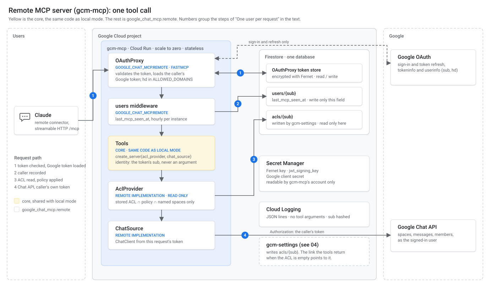

# 07 — The remote MCP server

> **Status: design only. Nothing in this document is implemented.** The tools still read the module globals `_cfg` and `_chat` in `server.py`; there is no `google_chat_mcp.remote` package and no HTTP entry point. Local mode (stdio) is unchanged by this document.

The remote version of the MCP server (issue #53): reachable by Claude as a custom connector over HTTP, one instance for many users, each with their own Google token and their own ACL, on the same core as local mode. It enforces the ACL that users save on `/settings` ([03](03-settings-ui-flow.md) for the flow, [04](04-settings-server-design.md) for the server that writes it).

Constraints from #29: GCP only (NFR-1), zero running cost for at most 40 users (NFR-2), a minimal database (NFR-3), the same Google identity as `/settings` (NFR-4), one core with local mode always runnable (NFR-6), and what may reach `main` while this is built (NFR-7). The decisions of 2026-11-04 apply as recorded in [04](04-settings-server-design.md#decisions-recorded-in-29); the ones that shape this document are: one instance per Workspace organisation, Firestore, two services, local mode kept as an alternative, and **no MCP tool except authentication may write the settings**.

---

## What was checked

Against the versions in `uv.lock` (FastMCP 4.1.5), by reading the installed code:

| Fact | Consequence |
|---|---|
| FastMCP ships `OAuthProxy` and a `GoogleProvider` built on it. Both take `client_storage` (any `AsyncKeyValue`), `jwt_signing_key`, `allowed_client_redirect_uris`, `require_authorization_consent`. | No OAuth server to write. The connector's authentication is configuration. |
| The proxy keeps its state (transactions, authorization codes, the map from FastMCP token IDs to upstream tokens, refresh tokens) only in `client_storage`, and its docstring says this is what allows several instances. | A Firestore-backed store makes `gcm-mcp` stateless between requests, which Cloud Run with scale to zero needs. |
| `py-key-value-aio` has a Firestore store (it needs that library's `firestore` extra, which is not installed today) and the proxy module references a Fernet encryption wrapper. | The store can be Firestore, encrypted at rest with a key `gcm-mcp` alone holds (04, "Isolation between users"). |
| `GoogleProvider` verifies tokens with Google's tokeninfo and userinfo endpoints, and its verifier takes an `audience`. | The caller's `sub` and email come from a token Google has just validated, never from a header or argument. |

What was **not** checked is in [To verify before implementation](#to-verify-before-implementation).

---

## Decisions

| # | Decision | Reason |
|---|---|---|
| M1 | **The tools are built by a factory**, `create_server(acl: AclProvider, chat: ChatSource, …) -> FastMCP`. The module globals `_cfg`, `_chat` and `init()` go away. Local and remote entry points call the same factory with different implementations. | The core must not know the mode (NFR-6). A factory takes the dependencies as arguments, so a test can run the same tools against both. |
| M2 | **Two interfaces, both resolved per request**: `AclProvider.acl()` returns an immutable `Acl` for the caller of this request; `ChatSource.client()` returns a `ChatClient` for the caller of this request. Local implementations return the same object every time; remote ones build it from the request's token. | One user per process is the only thing the current globals encode. Moving the user to the request is the whole change. |
| M3 | **One `Permissions` type, and one `Acl` type, in the core.** `Acl` is today's `SpaceConfig` (`require_read`, `require_write`, `requires_confirmation`, `list_spaces`), built from a mapping of space name to `Permissions`. The tools call it exactly as they call `_cfg` now. | The tools change by one line each (`_cfg.` becomes `acl.`), which is what makes the first refactoring safe for local users. |
| M4 | **The caller's identity is the `sub` of the validated token, and nothing else.** No tool takes a user, email or `sub` argument. If the token has no `sub`, the request fails. | Same rule as S7 in 04: impossible by construction, not by a check that could be forgotten. |
| M5 | **Chat calls use the caller's upstream access token**, carried by `OAuthProxy`. The tools never see a refresh token and never refresh. | The proxy refreshes the upstream token when the client refreshes its own. Refresh tokens stay in the encrypted store. |
| M6 | **`stateless_http=True`**: no MCP session lives in an instance's memory. | An instance can stop at any time (scale to zero, cap of 2). |
| M7 | **The ACL is read from Firestore on every call, with no cache between requests** (one read per request, remembered for that request only). A change saved on `/settings` applies on the next call. | A user who removes a space expects it to be gone at once, and a tightened admin policy must apply at once (S8 in 04). The read budget allows it ([Runtime and cost](#runtime-and-cost)). |
| M8 | **Effective permissions = stored ACL ∩ admin policy ∩ named spaces only**, computed inside the remote `AclProvider`. Entries that fail any of the three are not granted, and are reported as suspended, not as missing. | The admin-policy ceiling and the DM refusal are differences between modes, so they live in an implementation, never in a tool. |
| M9 | **Fail closed.** An unreadable ACL, a schema version this code does not know, a missing `sub` or `hd`, or an unparsable policy denies the call. Nothing falls back to "allow" or to local files. | A broken read must never widen access. |
| M10 | **An empty effective ACL makes every tool but `chat_auth_status` fail with a message holding `{SETTINGS_BASE_URL}/settings`.** The link comes from configuration, not from the request. | New users start with an empty ACL (03). The tools stay mode-blind: the message is raised by the provider. |
| M11 | **Tool arguments are not logged in remote mode.** Logs carry the tool name, the protocol, a hash of `sub`, and the space ID. | The log is held by the operator and mixes many users (comment on #29 about #43). Message text and filters are the user's. |
| M12 | **Its own package** `google_chat_mcp.remote` and its own entry point, `python -m google_chat_mcp.remote`, from the same image as `gcm-settings`. It refuses to start until every piece below exists. | NFR-6 and NFR-7. Partial work fails clearly. |

---

## Place in the codebase (NFR-6, NFR-7)

The table in [04](04-settings-server-design.md#packages-and-the-direction-of-dependencies) stays as is. This document fills in the core and `google_chat_mcp.remote`.

```
google_chat_mcp/
  permissions.py   core   Permissions, Acl, PermissionDeniedError           (from config.py and settings/models.py)
  schema.py        core   the `acls` and `users` documents: field names, schema_version, to/from dict (plain data, no Firestore import)
  interfaces.py    core   AclProvider, ChatSource (Protocols)
  tools.py         core   create_server(): the seven tools, the confirmation flow   (from server.py)
  chat/            core   ChatClient(credentials), unchanged except its constructor
  server.py        local  builds the server with the local implementations
  config.py        local  --space parsing -> a local AclProvider
  auth.py          local  token.json -> a local ChatSource
  __main__.py      local  stdio entry point, unchanged flags
  remote/
    __main__.py    remote the entry point of gcm-mcp
    firestore.py   remote Firestore client factory, shared by both remote services
    acl.py         remote Firestore AclProvider (read only)
    chat.py        remote ChatSource from the request's access token
    policy.py      remote admin policy (shared with gcm-settings)
    oauth.py       remote OAuthProxy / GoogleProvider setup, token store, domain check
    users.py       remote last_mcp_seen_at middleware
    logging.py     remote JSON logs for Cloud Logging
  settings/        remote gcm-settings (04)
```

- `tools.py` imports only core modules. It does not import `auth`, `config`, `remote` or `settings`, and does not read `os.environ`, `sys.argv` or the filesystem for configuration.
- `remote` imports the core, never `settings`; `settings` imports `remote.policy` and the core. The check in `tests/test_local_mode.py` already fails the build if a local module imports a remote package.
- The dependencies of remote mode (`google-cloud-firestore`, the Firestore store of `py-key-value-aio`, `cryptography` for Fernet) go in the `remote` extra, under the lock file and the audit job from #50. A local install does not pull them in; the `local-only` CI job checks it.

---

## The shared core


The diagram shows what NFR-6 asks for: one core, with the two modes as alternatives that each implement the same two interfaces. Every arrow points towards the core. The modules are named as in [Place in the codebase](#place-in-the-codebase-nfr-6-nfr-7). It is a plain SVG file and can be edited directly.

### `Permissions` and `Acl`

```python
@dataclass(frozen=True)
class Permissions:                      # core/permissions.py
    read: bool = False
    write: bool = False
    unattended: bool = False
    def validate(self) -> None: ...     # read or write; unattended implies write
```

The rules are the ones in `config.parse_space_arg` and `settings.models.Permissions.validate`, which today exist twice. After the refactoring there is one definition:

- `config.parse_space_arg` (local) parses `NAME:PERMS[:unattended]` into `Permissions`.
- The `/settings` pages and the Firestore reader build `Permissions` from stored fields and call `validate()`.
- `SpaceEntry` disappears. `require_confirmation` becomes `not permissions.unattended`.

`Acl` is `SpaceConfig` without the parsing: a mapping from space name to `Permissions`, immutable, with the same methods the tools use today. It is built once per request in remote mode and once per process in local mode. The text of the "not in allowlist" error is a constructor argument (`not_configured_hint`), because it differs between modes ([Differences](#intended-differences-between-the-modes)).

### The two interfaces

```python
class AclProvider(Protocol):            # core/interfaces.py
    async def acl(self) -> Acl: ...     # for the caller of the current request

class ChatSource(Protocol):
    async def client(self) -> ChatClient: ...
    def auth_status(self) -> dict: ...  # what chat_auth_status returns
```

| | Local | Remote |
|---|---|---|
| `AclProvider.acl()` | The `Acl` parsed from `--space` at start-up | Firestore `acls/{sub}` for the token's `sub`, intersected with the admin policy and the named-space rule (M8); raises `PermissionDeniedError` with the settings link when empty (M10) |
| `ChatSource.client()` | A `ChatClient` from `token.json`, created on the first call that needs it (as `_ensure_chat` does) | A `ChatClient` built from the request's upstream access token (M5) |
| `ChatSource.auth_status()` | The token file report that `chat_auth_status` returns today | Whether the request is authenticated, the granted scopes, and seconds to expiry |

- `ChatClient` takes its credentials as an argument (`ChatClient(creds)`) instead of calling `load_credentials()` itself. The local `ChatSource` calls `load_credentials()`; the remote one builds `google.oauth2.credentials.Credentials(token=…)`. Nothing else in `chat/` changes.
- `chat_auth_status` becomes `return chat.auth_status()`. The tool is mode-blind; the report is not.
- In remote mode the request context (the validated token) reaches the implementations through FastMCP's dependency mechanism, not through module state. **Nothing that belongs to a user is kept in a module-level variable.**

### "No tool checks the mode", and the test that enforces it

1. An AST test over `tools.py`: it imports nothing outside the core and the third-party libraries it already uses, and it does not read `os.environ` or `sys.argv`.
2. The tool tests run once per implementation pair. A fixture `mode` yields a local pair (an `Acl` from `--space` strings, a fake `ChatClient`) and a remote pair (an in-memory fake of the Firestore reader behind the same `AclProvider`, a fake token). Each test states the permission it needs; the fixture grants it in the way of its mode.
3. A concurrency test in remote mode: two callers with different `sub` call tools interleaved, and neither ever sees the other's ACL or token. This is the same trap as the NiceGUI one in 04, and for the same reason: per-request state must live in the request.

### Order of work (NFR-7)

Each step can be merged on its own, with local mode working and the NFR-7 tests green:

| # | Step | Local behaviour |
|---|---|---|
| 1 | **Done (#73, PR #74).** The shared base, in one pull request reviewed from both sides (#52 and #53).** `Permissions` and `Acl` in the core; the schema of the `acls` and `users` documents (`schema_version`, and `space_type` from the amendment above) as plain-data code in `schema.py`; the contract tests ([Testing](#development-and-tests)). `config.py` produces `Permissions`; `settings/models.py` imports it. Nothing that reads or writes these documents starts before it merges, so the schema does not change under parallel work. | Unchanged. Same errors, same output. |
| 2 | **Next.** **The factory and the two interfaces.** `server.py` becomes the local builder; `tools.py` holds the tools; `ChatClient(creds)`; `chat_auth_status` through `ChatSource`. Tests move to the `mode` fixture with the local pair only. | Unchanged. This is the step with the most risk for current local users: it is tried in a real client before `stable` moves. |
| 3 | **`remote.policy`** (moved from `settings/models.py`, with `ALLOWED_DOMAINS` and the `POLICY_*` variables), and the Firestore `AclProvider`, tested on the shared emulator fixture. The `mode` fixture gets its remote pair. | Unchanged. |
| 4 | **`remote.oauth`**: `GoogleProvider` or `OAuthProxy` with the encrypted Firestore store and the domain check. Tested against a fake upstream. | Unchanged. |
| 5 | **`remote.chat` and `remote.__main__`**: the remote `ChatSource`, the HTTP app, logging, the `users` middleware. From this step the service can be deployed (#60), from `stable` only. | Unchanged. |

**Parallel work.** Step 2 touches `server.py`, `tools.py`, `chat/` and the tool tests, and neither `settings/` nor the Firestore backends, so it can proceed while the settings side builds the emulator CI and its Firestore backend. Steps 3 to 5 need that emulator fixture and wait for it. `remote.policy` and `remote/firestore.py` are used by both services: whoever needs one first writes it, with a test, and the other imports it.

Until step 5, each pull request says what is still missing, and `python -m google_chat_mcp.remote` stops with "not implemented yet". Step 2 of the order in 04 (`Permissions` in the core) is step 1 here: the two orders are one.

---

## Remote mode



The diagram follows one tool call through `gcm-mcp`; the architecture of both services is in [04](04-settings-server-design.md#architecture). The numbers group the steps of [One user per request](#one-user-per-request): 1 is its step 1, 2 is step 2, 3 is steps 3 and 4, and 4 is step 5. It is a plain SVG file and can be edited directly.

### Transport and connector authentication

- **Streamable HTTP at `/mcp`**, `stateless_http=True` (M6). `gcm-mcp` runs under `uvicorn`, which FastMCP already depends on.
- **`OAuthProxy` in front of Google.** Claude is the OAuth client of `gcm-mcp`; `gcm-mcp` is the OAuth client of Google. Claude registers itself with the proxy (dynamically or by client ID metadata: to verify); the proxy uses one fixed Google OAuth client.
- `allowed_client_redirect_uris` is restricted to Claude's callback addresses (to read from the current Claude documentation before implementing), not left at the permissive default.
- **`require_authorization_consent=True`** (the default): the proxy shows its own consent page before it sends the user to Google. This is what protects against the confused-deputy problem of an OAuth proxy that uses one upstream client for many downstream ones. It is not turned off to save a click.
- **Scopes:** `openid`, `email`, and the four Chat scopes that local mode uses today. `openid` and `email` are what give the connector a `sub`; local mode does not need them.
- **Google OAuth client:** the connector's own "Web application" client, in the same project and under the same consent screen (Internal) as the settings client in [04](04-settings-server-design.md#oauth-client). Its redirect URI is `{BASE_URL}/auth/callback`, with `BASE_URL` the address of `gcm-mcp`. Two clients keep two secrets apart; `sub` is per account, so both see the same value.
- **Domain check.** The connector's token verifier is wrapped to reject any account whose `hd` is not in `ALLOWED_DOMAINS` (exact, case-insensitive, no subdomains, no `hd` means refused: the same rule as `/settings`). It runs on every request, not only at sign-in, so removing a domain applies at once. The Internal consent screen is the first barrier; this is the second.
- **`audience`** of the Google verifier is set to this service's client ID, so a token issued to another OAuth client is refused.

### Token store

- `client_storage` is the Firestore store of `py-key-value-aio`, in its own collection, wrapped in Fernet encryption. This is the "OAuthProxy token store (encrypted)" row of 04.
- **Two secrets, both in Secret Manager, readable by `gcm-mcp`'s service account only:** the Fernet key and the proxy's `jwt_signing_key`. `gcm-settings` has no access to either (04, "Contribution to one service or two").
- **Rotation:** Fernet supports a list of keys, newest first, so a key can be rotated by adding the new one in front, redeploying, and removing the old one after the longest token lifetime. The procedure belongs to #60.
- **TTL:** entries carry their own expiry; a Firestore TTL policy on that field removes them. To check that the store writes a field a TTL policy can use ([To verify](#to-verify-before-implementation)).
- **Losing the encryption key** is not a disaster: every user signs in again. It does not touch ACLs.

### One user per request

For a tool call:

1. `OAuthProxy` validates the FastMCP token, looks up the upstream Google token and the claims. A failure is a `401` before any tool runs.
2. The `users` middleware records `last_mcp_seen_at` for the `sub` (below). It never fails the call.
3. The tool asks `AclProvider.acl()`. The remote implementation reads `acls/{sub}` once, checks `schema_version` (M9), applies the policy and the named-space rule (M8), and returns an `Acl`. The result is remembered for the rest of that request.
4. The tool applies `acl.require_read` / `require_write` / `requires_confirmation` exactly as it does today.
5. Only then does it ask `ChatSource.client()`, so a denied call makes no Chat call and no extra Firestore read.

### What `AclProvider` reads, and what it refuses

- It reads `acls/{sub}` and nothing else of the ACL; it has no write method. It does not import the settings package, `AclStore`, or any module that writes `acls`, `audit` or `sessions` (04, "Access to Firestore by service"; the CI check stays).
- **Named spaces only.** In v1 the settings page never stores a direct message or a group chat, and a hand-edited document must not grant one. The provider needs to know an entry's space type without a Chat call on every read. **Amendment to the data model of 04:** each entry also stores `space_type`, written by `/settings` from the `spaces.get` it has just made (it already checks `spaceType == SPACE`). The provider grants an entry only if `space_type == "SPACE"`; a missing or different value is not granted (M9). A space can be turned from a group chat into a named space but not back, so a stored `SPACE` stays true; to confirm ([To verify](#to-verify-before-implementation)).
- **Policy.** An entry the policy forbids is not granted. `list_spaces` does not show it; the denial message says the administrator has suspended it. Loosening the policy restores it without anyone saving again (04, "Admin policy").
- **Schema.** The reader accepts the current and the previous `schema_version` and upgrades the older one in memory; a newer one is refused (04, "Schema versioning").

### `users/{sub}`

- Middleware, not a tool, writes `users/{sub}` with `last_mcp_seen_at`, at most once an hour **per instance** (an in-memory map of the last write, so no read is needed to decide). It is a `set` with merge on that one field, plus `created_at` and `email` the first time. No other field of any other document is written by `gcm-mcp`, except the proxy's own store.
- A failure to write is logged and ignored.
- Cloud Run may throttle CPU once the response is sent, so the write happens inside the request, before the response, and only when due.

### Confirmation of sends

The confirmation flow in `server.py` (`_confirm_send`, the elicitation on older protocols, `InputRequiredResult` on 2026-07-28+) moves to `tools.py` unchanged. In stateless mode:

- On the modern protocol, the first call returns `InputRequiredResult` and the client retries with the answer. Nothing is kept in the server, so it works as is.
- On older protocols, `ctx.elicit` needs a server-to-client request on the same connection, which a stateless request cannot hold. In that case `_client_supports_elicitation` is false and the tool falls to the existing branch: the send goes ahead and relies on the client's per-tool approval, with the same log line as today. This is the behaviour local users already have with clients that cannot elicit. **Which protocol Claude's connector speaks must be verified before deployment**; if it is the older one, `send_message` loses its server-side confirmation in remote mode and the user guide (#59) must say so.
- `send_message_unattended` is unchanged. The `/settings` page, not this server, decides which spaces may use it.

### No tool writes the settings

No tool, and no code path reachable from a tool, writes `acls`, `audit` or `sessions`. A test runs every tool against the Firestore emulator and checks that nothing outside the proxy's store and `users/{sub}.last_mcp_seen_at` changed (the test already specified in 04). The settings link in M10 is built from `SETTINGS_BASE_URL`; it never contains data from a request or from Chat.

---

## Intended differences between the modes

Each difference lives in one implementation, never in a tool. This table is the source for the migration guide in #59.

| Difference | Local | Remote | Lives in |
|---|---|---|---|
| Source of permissions | `--space` flags, written by whoever starts the process | `/settings`, per signed-in user, within the admin policy | `AclProvider` |
| Admin ceiling | none | `POLICY_*` and `ALLOWED_DOMAINS` | `remote.policy` |
| Direct messages and group chats | readable with `--space spaces/DM…:r` | refused, even if stored | remote `AclProvider` |
| Space not configured | "Add it with `--space` in the Claude configuration file." | A message with the `/settings` link | `Acl.not_configured_hint` |
| Empty configuration | tools work, `list_spaces` returns `[]` | every tool but `chat_auth_status` fails with the `/settings` link | remote `AclProvider` |
| Authentication | `token.json`, `google-chat-mcp auth` | OAuth through the connector, per user | `ChatSource` |
| `chat_auth_status` | token file report; works with no token | reports the signed-in session; with no valid token the request is refused before the tool | `ChatSource.auth_status()` |
| Sends on older MCP protocols | server-side confirmation if the client can elicit | probably none (stateless), see above | transport |
| Logs | owner-only file in `~/.config`, with tool arguments | Cloud Logging, no arguments, `sub` hashed | entry point |
| Permissions are shared between modes | no | no | nothing is synchronised (NFR-6) |

---

## Logging

- **Destination:** stdout as JSON, which Cloud Run sends to Cloud Logging. No file.
- **Content:** tool name, protocol, elicitation flag, hashed `sub`, space ID, outcome. **Not** message text, filters, page tokens or space display names (M11). The middleware that logs arguments today takes a redaction function from the factory; the remote one drops them all.
- **Email masking from #43** (already merged as #48) applies to the formatter on every handler. The remote entry point must install the formatter and the FastMCP filter itself: `main()` of the local CLI does that today, and the remote entry point does not run it.
- **uvicorn** configures its own loggers. Its `log_config` is given the same masking formatter, and access logs are turned off, since the URL of an OAuth callback carries `code` and `state`.
- **Alerts:** the structured `acl_change` lines of 04 come from `gcm-settings`. `gcm-mcp` adds one line per denial (tool, reason class, hashed `sub`), enough to alert on a burst of denials.

---

## Development and tests

The cycle is shared with the settings backend and is described in [06-dev-cycle.md](06-dev-cycle.md): one repository, one image, one pipeline, the levels L0 to L3, the emulator, what only GCP can check. It is not repeated here. This section is what the MCP service adds to it, using the same level names. The Chat API is never emulated: tests use a fake `ChatSource`, and the real API is tried in L3 and on GCP.

| Level | What runs | What it covers on the MCP side |
|---|---|---|
| **L0** | `pytest`, in memory | The tool tests with the `mode` fixture: the local pair in every job, the remote pair (fake Firestore reader, fake token, fake `ChatClient`) in the job with the `remote` extra. The AST test on `tools.py`. The interleaved-callers test. |
| **L1** | `pytest` against the Firestore emulator (a service container in CI) | The Firestore `AclProvider`: schema versions, policy, `space_type`, fail closed on every unreadable case. The `users` middleware. The token store layout and its expiry field. The test that every tool leaves every document unchanged except the proxy's store and `users/{sub}.last_mcp_seen_at`. |
| **L2** | `python -m google_chat_mcp.remote` on the developer's machine, with the emulator | The HTTP app end to end, driven by a FastMCP client. The Google token verifier is replaced by a development one that accepts a fixed test token. Like the settings mock, it declares itself development-only, refuses to run unless asked explicitly, and is never imported by the production entry point (NFR-7, rule 4). *Proposed.* |
| **L3** | The same, with the real Google sign-in | A development OAuth client with redirect `http://localhost:…/auth/callback`, the emulator, and the real Chat API, driven by the MCP Inspector or a FastMCP client. Claude's connector is expected to call the server from Anthropic's side and so not to reach `localhost` (to verify): the real connector is tried on GCP. |
| **GCP** | The dev deployment | Everything marked `[GCP]` in [To verify](#to-verify-before-implementation). |

- **The emulator fixture** is the single one in `tests/` that 06-dev-cycle.md prescribes; the MCP tests do not start their own.
- **Contract tests on the schema**, both directions: documents written by the settings `AclStore` are read by the MCP provider and grant exactly what was saved; `users/{sub}` written by the MCP middleware is read by the settings code. A set of **golden documents** for the current and the previous `schema_version` is read by both sides, which is what makes the readers-first rule testable.
- **Image smoke test in CI**, for the MCP command: until step 5, `python -m google_chat_mcp.remote` is expected to stop with its "not implemented yet" exit; from step 5 the test starts it against the emulator and checks that `/mcp` without a token answers `401`.

---

## Environments and deploy

The module, the environments and the pipeline are in [06-dev-cycle.md](06-dev-cycle.md) ("IaC and deployment"); this is what the MCP service needs from them.

- **One or two GCP projects is an open decision there** (recommended: two). Either way, each environment has its **own** OAuth clients, Fernet key and `jwt_signing_key`, never copied between them.
- **A dev project outside the Workspace organisation cannot use an Internal consent screen.** The dev project must be created inside the same organisation, or the dev flow differs from production in the one place that matters for the `hd` check. To verify.
- **Secrets:** Terraform creates the Secret Manager containers, not their values. The Google client secret is entered by hand at bootstrap, as 04 already assumes; the Fernet key and the `jwt_signing_key` are generated by the operator at bootstrap and added as versions. This goes in #60.
- **Rollback** by moving traffic to the previous revision works because `gcm-mcp` is stateless (M6) and has no session affinity. A rollback across a schema change fails closed (M9): that is why a new schema is read first and written second, each in its own `stable`.
- **Proposed change to 06-dev-cycle.md:** drop "the ACL schema version" from the values Terraform defines once. In this design the version is a constant in `schema.py`, written into each document, so a deployment variable would say the same thing in a second place and could disagree with the code. To settle with the settings side.
- **Proposed addition to its "done only on GCP" list:** the items of [To verify](#to-verify-before-implementation) marked `[GCP]`.

---

## Runtime and cost

| Item | Setting |
|---|---|
| Cloud Run `gcm-mcp` | request-based billing, `min-instances=0`, `max-instances=2`, 512 MiB, 1 vCPU, request timeout 300 s, same image as `gcm-settings`, command `python -m google_chat_mcp.remote`. **No session affinity**: the server is stateless (M6). |
| Service account | `gcm-mcp@`: `roles/datastore.user` on the one database (04, "Access to Firestore by service"), `secretmanager.secretAccessor` on the Google client secret, the Fernet key and the JWT signing key only. |
| Configuration | `BASE_URL`, `SETTINGS_BASE_URL`, `ALLOWED_DOMAINS`, `POLICY_*`, the Firestore database ID, the Google client ID; secrets by reference. The shared ones come from the same Terraform module as `gcm-settings`. |

**Firestore reads per tool call.** The ACL: 1. The proxy's store: a few (token lookup, JTI mapping, upstream token), to count with the emulator. At 40 users × 200 calls a day = 8 000 calls, three or four reads each is 24 000 to 32 000 reads a day against the 50 000 free (04 counted only the ACL read). This is the figure closest to the limit for `gcm-mcp`. If the measured count is too high, the first remedy is a short in-process cache **of the proxy's token lookups**, not of the ACL (M7). Writes: `last_mcp_seen_at` is rare; the proxy writes only at sign-in and refresh.

**Cold start:** after an idle period the first call starts a container: Python, FastMCP, the Firestore client, secrets. Accepted, as in 04. The Firestore client and the secrets are loaded in the HTTP app's lifespan, not at import. A cold start that lands in the middle of the OAuth callback is correct, only slower, because the proxy's transaction is in Firestore.

**Streams.** A tool call that returns promptly holds the instance only for its duration. Nothing in `gcm-mcp` keeps a stream open between calls.

---

## Security notes specific to this server

| Risk | Defence |
|---|---|
| **A user reaches another user's spaces** | `sub` only from the validated token (M4); ACL and `ChatClient` are per request (M2); no user state in module variables; the interleaved-callers test. Google itself also limits the Chat token to the user's own spaces: the ACL is only a further restriction. |
| **Prompt injection widens permissions** | No tool can write the ACL (see [No tool writes the settings](#no-tool-writes-the-settings)). The settings link is fixed configuration. Reading text that tells the model to "enable all spaces" has no tool to act on. |
| **Prompt injection steers an unattended send** | Same exposure as local mode: text read from any readable space can influence posts to an unattended space. The warnings are on `/settings` (03, step 6). Nothing new is added here. |
| **Confused deputy at the OAuth proxy** | `require_authorization_consent=True`, redirect URIs restricted to Claude's callbacks. |
| **A token issued to another OAuth client is replayed** | Verifier `audience` is this service's client ID. |
| **Account outside the organisation** | Internal consent screen, then the `hd` check on every request. |
| **Stolen token store** | Encrypted with a key held only by `gcm-mcp`. Refresh tokens are stored by hash. |
| **A compromised `gcm-mcp`** | It can use the Chat tokens of users who connected, and, because Firestore IAM cannot split collections, write the ACL (04, "Residual risk"). The audit log and alerts are the detection. |
| **Logs** | M11. |

---

## What the tools change

For review: the diff of the tools in step 2 is small and mechanical.

| Today (`server.py`) | After (`tools.py`) |
|---|---|
| `_cfg.require_read(space_name)` | `acl = await provider.acl()`; `acl.require_read(space_name)` |
| `_ensure_chat().spaces.get(…)` | `(await chat.client()).spaces.get(…)` |
| `_resolve_send_target(space_name)` | the same, taking the client as an argument |
| `_cfg.list_spaces()` | `acl.list_spaces()` |
| `chat_auth_status()` reads `token.json` | `chat.auth_status()` |
| `init(space_args)` sets globals | `create_server(provider, chat, redact=…)` returns the app |

The tool functions become `async` where they now await the provider. FastMCP runs both forms; the descriptions, annotations and return types the clients see do not change, and the test of the exact tool list in `tests/test_local_mode.py` guards that.

---

## To verify before implementation

`[local]` can be checked on a developer's machine (L1 to L3 in [06-dev-cycle.md](06-dev-cycle.md)); `[GCP]` only in the dev project.

1. `[GCP]` **Claude's connector:** the exact OAuth callback addresses to allow; whether it registers dynamically or by client ID metadata; which MCP protocol version it speaks (this decides the confirmation of sends, above); and that it cannot reach `localhost`.
2. `[local]` **`GoogleProvider` claims:** that the validated token's claims carry `sub` and `email`, and that the verifier can be wrapped to apply the domain check on every request. `[GCP]` that `hd` is present, including for users on a secondary domain (shared with 04, item 5).
3. `[local]` **Upstream refresh:** that the proxy refreshes the Google access token when the client refreshes its own. `[GCP]` what the client sees if the Google refresh token is revoked.
4. `[local]` **Token store:** the Firestore store's document layout and expiry field, so a TTL policy can clean it; the number of reads per tool call; whether the Fernet wrapper accepts a key list for rotation. `[GCP]` that the TTL policy deletes them.
5. `[local]` **Stateless mode:** that `stateless_http=True` works with the proxy's authentication and with `InputRequiredResult`, and what `check_client_capability` returns when no `initialize` was seen.
6. `[GCP]` **Space type:** that a space never turns from `SPACE` into another type, so the stored snapshot of `space_type` stays true.
7. `[GCP]` **Google Chat API limits:** per-user and per-project quotas for `spaces.get`, `messages.list`, `messages.create`, since all users share one project's quota. Not stated here because they were not checked.
8. `[GCP]` **Internal consent screen:** that refresh tokens for an Internal app do not expire after 7 days (the limit local mode warns about applies to apps in Testing), that no Google verification of the app is needed, and that a dev project inside the organisation can use it.
9. `[GCP]` **Cloud Run:** a streamable HTTP response is billed only while it runs; the free-tier regions (shared with 04, item 4); the cold start with FastMCP and the Firestore client imported.
10. `[local]` **`ALLOWED_DOMAINS` and `POLICY_*` names:** `Policy` in `settings/models.py` has an `allow_read` flag that no variable in 04 sets. Align the two before moving the type to `remote.policy`.

---

## Out of scope

- The settings UI and its backend ([03](03-settings-ui-flow.md), [04](04-settings-server-design.md)), except the `space_type` amendment above.
- Implementation, CI/CD and Terraform (later phases of #29).
- Documentation for operators and users (#58 local, #59 remote and migration, #60 and #61 deployment).
- Reading direct messages remotely (decision 4 on #29), and any admin-defined policy beyond the four variables of 04.
- Deleting a user's data on request: `users/{sub}`, the proxy's store entries and `acls/{sub}` belong to two services; to design with the deployment documents.
